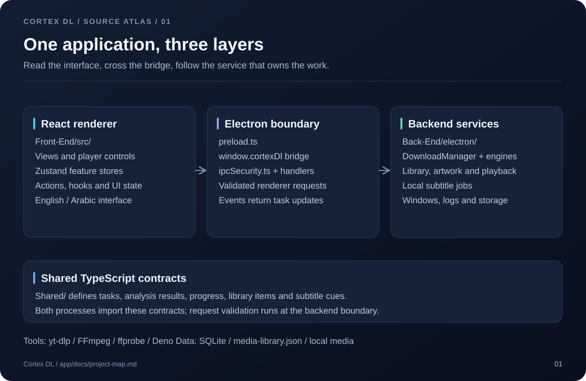

<p align="center">
  
</p>

# Cortex DL

A Windows desktop app for downloading video and audio, managing local media, and creating subtitles. Built with Electron, React and TypeScript, with English and Arabic interfaces.

[](https://github.com/SAADX25/Cortex-DL/actions/workflows/validation.yml)
[](LICENSE)

[Download](https://github.com/SAADX25/Cortex-DL/releases/latest) · [Code map](app/docs/project-map.md) · [Contributing](CONTRIBUTING.md) · [Changelog](CHANGELOG.md)

## What it does

- Downloads from yt-dlp-supported sites, direct URLs and HLS streams.
- Offers video quality, audio formats, trimming, playlists and batch queues.
- Keeps download history, pause/resume state and settings across restarts.
- Plays local media in the app or a floating window, with cover editing.
- Organizes a media library without moving the original files.
- Generates, translates, reviews and exports subtitles with local models.

## Source layout



```text
Cortex-DL/
├── app/
│   ├── Front-End/src/       React views, state and user actions
│   ├── Back-End/electron/   Windows, IPC, downloads and native tools
│   ├── Shared/              Types and rules used by both processes
│   ├── scripts/             Build, engine, cleanup and release checks
│   ├── tests/               Regression tests and Electron fixtures
│   ├── build/               Windows installer source
│   └── docs/                Code map and development guide
├── .github/                 CI, issue templates and PR template
├── assets/                  Repository branding
├── Cortex_Dev.bat           Windows development launcher
└── package.json             Commands forwarded to app/
```

Open the **[complete source layout](app/docs/project-map.md)** for every source file, eight visual diagrams and a feature-to-file index. The [development guide](app/docs/development.md) explains the rules behind those modules.

## Run locally

Use Windows x64, Git and Node.js 24.

```powershell
git clone https://github.com/SAADX25/Cortex-DL.git
cd Cortex-DL
npm run setup
npm run dev
```

Setup installs the locked dependencies and local Git tag guards. Development startup downloads and verifies media engines when needed. Subtitle models are downloaded separately from the subtitle workspace.

Run these commands from the repository root:

| Command | Purpose |
| --- | --- |
| `npm run dev` | Start Vite and Electron. |
| `npm run check` | Run TypeScript, ESLint and all tests. |
| `npm run test:release` | Test release-tag safeguards in disposable Git repositories. |
| `npm run build` | Build the Windows installer without publishing. |
| `npm run clean:preview` | Preview generated files eligible for cleanup. |
| `npm run clean` | Remove generated development output. |

Media tests need staged engines: run `npm --prefix app run engines:stage` if they are missing. See [Contributing](CONTRIBUTING.md) for installer tests and release steps.

## Builds and local data

Installers are written to `app/release/<version>/Cortex-DL-Setup-<version>.exe`, alongside update metadata. Published installers are available on [GitHub Releases](https://github.com/SAADX25/Cortex-DL/releases).

The installed app keeps its data in `%APPDATA%\cortex-dl`:

| Location | Contents |
| --- | --- |
| `tasks.sqlite` | Download history and settings. |
| `media-library.json` | Saved references to local media. |
| `bin/` | Verified media engines and integrity receipts. |
| `local-subtitles/` | Subtitle tools and models. |
| `logs/` | Diagnostic logs. |

First-run engine setup needs internet access. Healthy engines are reused on later launches. Use **Settings → Repair Engines** or **Open Logs** to troubleshoot setup.

Download partials live under `.cortex_temp/<taskId>/<attemptId>` in the selected download folder. Paused or failed tasks keep partials for recovery; completed and canceled tasks clean them up.

Closing the window hides the app in the tray. Use the tray's exit action to quit. App updates preserve application data; uninstalling offers a choice to keep or remove it. Downloaded media files stay in place.

## Help and license

Use the [bug report](https://github.com/SAADX25/Cortex-DL/issues/new?template=bug_report.md) for reproducible problems. Report vulnerabilities privately through the [security policy](SECURITY.md).

The application source uses the [MIT license](LICENSE). Downloaded engines and models retain their own licenses.
