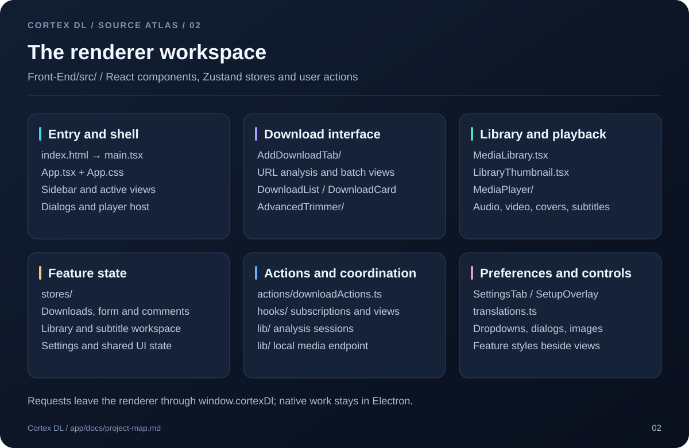
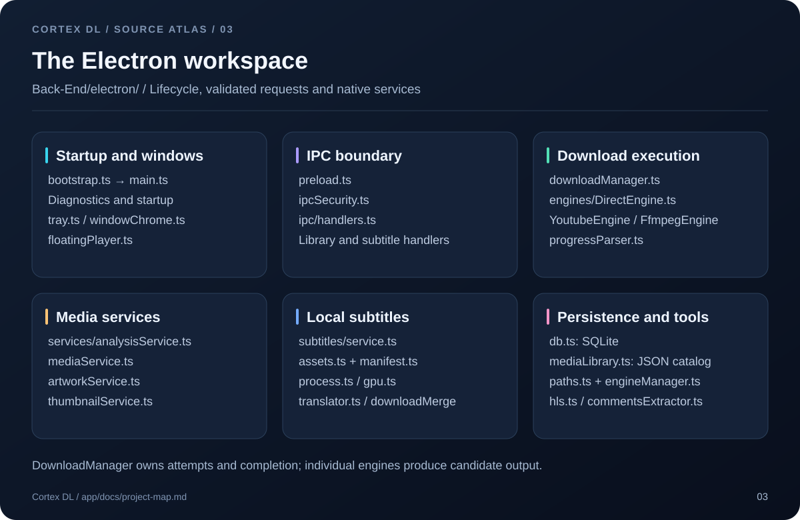
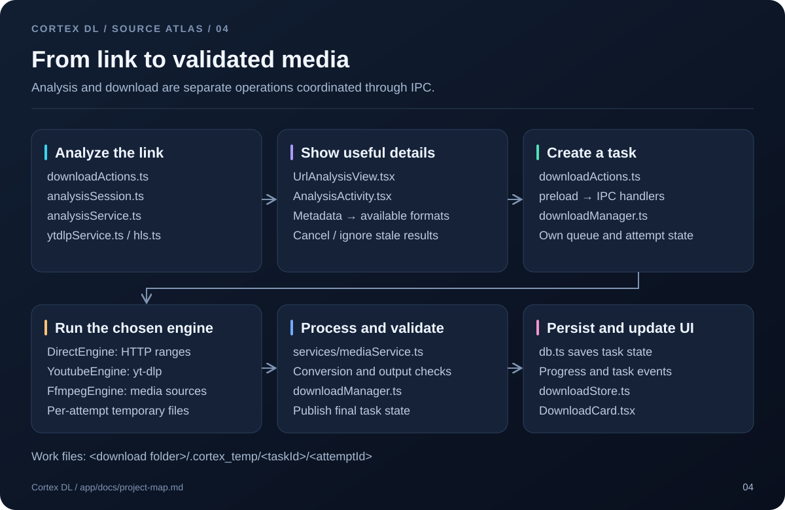
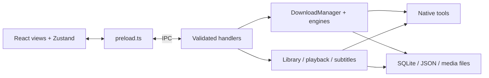
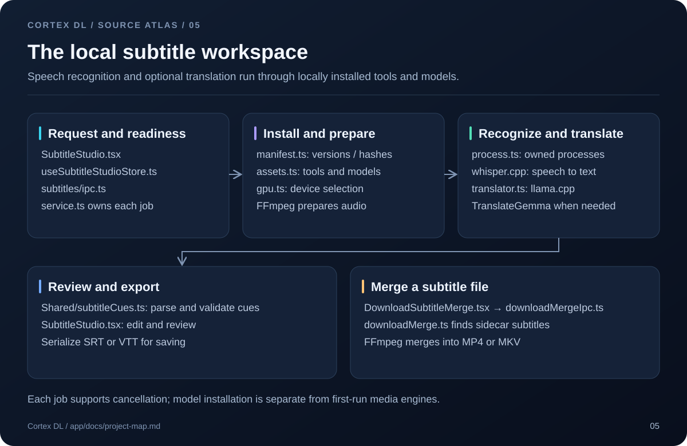
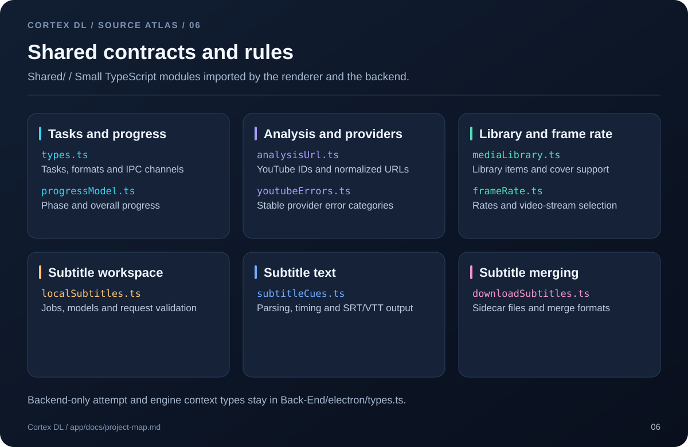
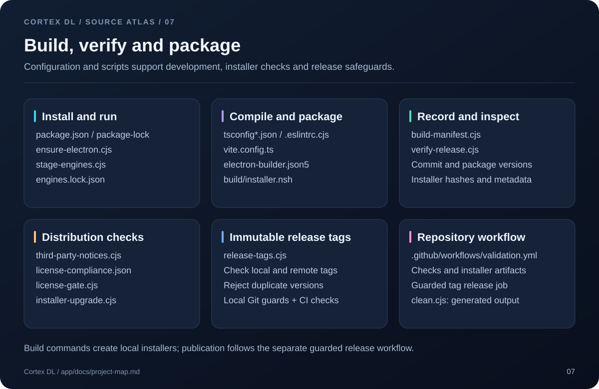
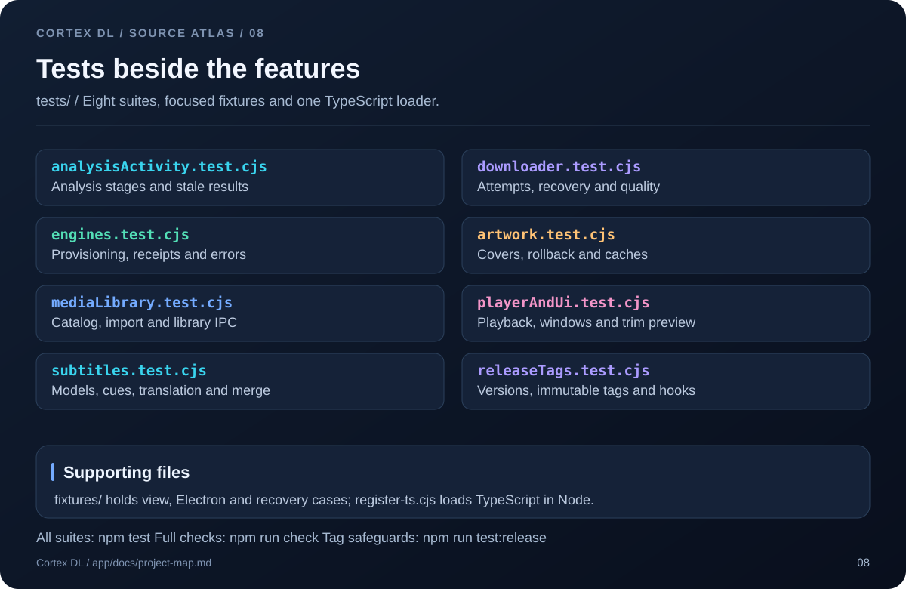

# Source layout

Cortex DL has three code layers: the React interface, the Electron backend, and shared TypeScript contracts. The application lives in `app/`; root npm commands forward to it.


## Repository

This map includes every tracked source file and the pending release-tag safeguards. Expand a tree for a short description of each file. Dependencies, generated output and private local settings are listed separately below.

```text
Cortex-DL/
├── app/
│   ├── Front-End/          React interface and static app icon
│   ├── Back-End/electron/ Electron lifecycle, IPC and native work
│   ├── Shared/            Contracts and pure helpers for both processes
│   ├── scripts/           Development, packaging and release checks
│   ├── tests/             Feature suites and isolated fixtures
│   ├── build/             Tracked Windows installer source
│   └── docs/              Source atlas, diagrams and development rules
├── .github/               CI, funding and contributor templates
├── assets/                Repository branding
├── Cortex_Dev.bat          Windows development launcher
└── package.json            Root command shortcuts
```

<details>
<summary>Root files, branding and GitHub workflow</summary>

```text
Cortex-DL/
├── .github/
│   ├── ISSUE_TEMPLATE/
│   │   ├── bug_report.md                                          # Bug report form
│   │   └── feature-request.md                                     # Feature request form
│   ├── workflows/
│   │   └── validation.yml                                         # Windows checks, installer validation and guarded releases
│   ├── FUNDING.yml                                                # Sponsor links
│   └── PULL_REQUEST_TEMPLATE.md                                   # Pull request checklist
├── assets/
│   └── logo.png                                                   # Repository logo
├── .gitignore                                                     # Generated files and local data exclusions
├── CHANGELOG.md                                                   # Release history and pending changes
├── CODE_OF_CONDUCT.md                                             # Community expectations and contact
├── CONTRIBUTING.md                                                # Setup, checks and release-tag workflow
├── Cortex_Dev.bat                                                 # Windows development launcher
├── LICENSE                                                        # Application source license
├── package-lock.json                                              # Root dependency lock
├── package.json                                                   # Root commands forwarded to app/
├── README.md                                                      # Product overview and quick start
└── SECURITY.md                                                    # Private vulnerability reporting
```

</details>

## Frontend

Start at [main.tsx](../Front-End/src/main.tsx) and [App.tsx](../Front-End/src/App.tsx). Views use feature stores and call the backend through `window.cortexDl`. Component styles stay beside the feature; `App.css` holds shared layout and theme rules.



<details>
<summary>Complete Front-End/ tree</summary>

```text
app/Front-End/
├── public/
│   └── CortexDL.ico                                               # Application icon
├── src/
│   ├── actions/
│   │   └── downloadActions.ts                                     # Analyze links and dispatch download actions
│   ├── components/
│   │   ├── AddDownloadTab/
│   │   │   ├── AnalysisActivity.css                               # Styles for AnalysisActivity
│   │   │   ├── AnalysisActivity.tsx                               # Analysis stages, elapsed time and loading feedback
│   │   │   ├── BatchListView.tsx                                  # Pending batch entries
│   │   │   ├── PlaylistView.css                                   # Styles for PlaylistView
│   │   │   ├── PlaylistView.tsx                                   # Playlist selection and queue actions
│   │   │   └── UrlAnalysisView.tsx                                # Metadata preview, formats and comment actions
│   │   ├── AdvancedTrimmer/
│   │   │   ├── AdvancedTrimmer.css                                # Styles for AdvancedTrimmer
│   │   │   ├── AdvancedTrimmer.tsx                                # Visual start/end selection
│   │   │   ├── trimAudio.ts                                       # Synchronize preview audio and video
│   │   │   ├── trimPreview.ts                                     # Preview lifecycle, fallback and seeking
│   │   │   └── trimSource.ts                                      # Choose a browser-compatible preview stream
│   │   ├── icons/
│   │   │   └── YouTubeMusicIcon.tsx                               # YouTube Music icon
│   │   ├── MediaPlayer/
│   │   │   ├── AudioPlayerView.tsx                                # Audio playback view
│   │   │   ├── mediaDiagnostics.ts                                # Track renderer media resource counts
│   │   │   ├── MediaInfoOverlay.tsx                               # Media properties overlay
│   │   │   ├── MediaPlayer.css                                    # Styles for MediaPlayer
│   │   │   ├── MediaPlayerModal.tsx                               # Player session and view coordinator
│   │   │   ├── mediaSession.ts                                    # Release media, canvas and audio resources
│   │   │   ├── PlayerArtworkMenu.tsx                              # Cover selection and editing actions
│   │   │   ├── PlayerControls.tsx                                 # Seek, volume and playback controls
│   │   │   ├── PlayerHeader.tsx                                   # Player title and window actions
│   │   │   ├── SubtitleMenu.tsx                                   # Subtitle tracks and display settings
│   │   │   ├── useFloatingPlayer.ts                               # Floating player coordination
│   │   │   └── VideoPlayerView.tsx                                # Video playback view
│   │   ├── Subtitles/
│   │   │   ├── DownloadSubtitleMerge.css                          # Styles for DownloadSubtitleMerge
│   │   │   ├── DownloadSubtitleMerge.tsx                          # Merge subtitles into downloaded media
│   │   │   ├── SubtitleLanguageSelect.css                         # Styles for SubtitleLanguageSelect
│   │   │   ├── SubtitleLanguageSelect.tsx                         # Subtitle language picker
│   │   │   ├── SubtitleStudio.css                                 # Styles for SubtitleStudio
│   │   │   └── SubtitleStudio.tsx                                 # Generate, review, translate and export subtitles
│   │   ├── AddDownloadTab.tsx                                     # Download form and analysis workspace
│   │   ├── AnimatedSegmentedControl.tsx                           # Animated option selector
│   │   ├── ArtworkProgress.css                                    # Styles for ArtworkProgress
│   │   ├── ArtworkProgress.tsx                                    # Cover-editing progress feedback
│   │   ├── ConfirmModal.tsx                                       # Reusable confirmation dialog
│   │   ├── CustomDropdown.tsx                                     # Reusable dropdown control
│   │   ├── DownloadCard.css                                       # Styles for DownloadCard
│   │   ├── DownloadCard.tsx                                       # One task, progress and task actions
│   │   ├── DownloadList.css                                       # Styles for DownloadList
│   │   ├── DownloadList.tsx                                       # Queue and history view
│   │   ├── LibraryThumbnail.tsx                                   # Library artwork display
│   │   ├── MediaLibrary.css                                       # Styles for MediaLibrary
│   │   ├── MediaLibrary.tsx                                       # Local media browser and import actions
│   │   ├── SettingsTab.tsx                                        # Preferences, diagnostics and engine repair
│   │   ├── SetupOverlay.css                                       # Styles for SetupOverlay
│   │   ├── SetupOverlay.tsx                                       # First-run engine setup and retry view
│   │   ├── Sidebar.tsx                                            # Main navigation and external links
│   │   ├── SmartImage.tsx                                         # Image loading and fallback
│   │   └── UrlInputBar.tsx                                        # URL entry, clear and analyze controls
│   ├── constants/
│   │   ├── formats.ts                                             # Renderer format choices
│   │   └── limits.ts                                              # Interface limits
│   ├── hooks/
│   │   ├── types.ts                                               # Shared modal configuration type
│   │   ├── useDebounce.ts                                         # Delay rapidly changing values
│   │   ├── useDownloadCardVM.ts                                   # Format task data for download cards
│   │   ├── useDownloadInit.ts                                     # Initial task load and event subscriptions
│   │   ├── useHighFrequencyIPC.ts                                 # Efficient progress updates and store throttling
│   │   └── useSettingsInit.ts                                     # Load saved preferences
│   ├── lib/
│   │   ├── analysisSession.ts                                     # Current analysis stages and stale-result protection
│   │   ├── downloadHelpers.ts                                     # Provider detection and readable IPC errors
│   │   ├── mediaEndpoint.ts                                       # Load and build local media URLs
│   │   └── variantLabel.ts                                        # Localized HLS quality labels
│   ├── stores/
│   │   ├── downloadStore.ts                                       # Download tasks and updates
│   │   ├── useCommentsStore.ts                                    # Comment export state
│   │   ├── useFormStore.ts                                        # URL, formats and form choices
│   │   ├── useMediaLibraryStore.ts                                # Library items and import state
│   │   ├── useSettingsStore.ts                                    # Preferences and language state
│   │   ├── useSubtitleStudioStore.ts                              # Subtitle jobs, cues and readiness
│   │   └── useUIStore.ts                                          # Navigation and shared interface state
│   ├── App.css                                                    # Shared layout, theme and base styles
│   ├── App.tsx                                                    # Navigation, dialogs and player host
│   ├── main.tsx                                                   # Mount the React application
│   ├── translations.ts                                            # English and Arabic interface text
│   └── vite-env.d.ts                                              # Renderer build-time declarations
└── index.html                                                     # Renderer HTML entry
```

</details>

## Backend

[bootstrap.ts](../Back-End/electron/bootstrap.ts) is the build entry. [main.ts](../Back-End/electron/main.ts) owns runtime services and windows. [preload.ts](../Back-End/electron/preload.ts) exposes the bridge; [ipcSecurity.ts](../Back-End/electron/ipcSecurity.ts) and feature handlers validate requests.



<details>
<summary>Complete Back-End/electron/ tree</summary>

```text
app/Back-End/electron/
├── engines/
│   ├── DirectEngine.ts                                            # HTTP range downloads
│   ├── engineManager.ts                                           # Provision, verify and repair native engines
│   ├── FfmpegEngine.ts                                            # FFmpeg-driven source downloads
│   ├── IEngine.ts                                                 # Download engine interface
│   ├── MediaProcessor.ts                                          # Frame-rate probes
│   ├── YoutubeEngine.ts                                           # yt-dlp download execution
│   └── ytdlpService.ts                                            # Metadata, formats and preview stream extraction
├── ipc/
│   ├── handlers.ts                                                # Download, analysis and app request handlers
│   └── mediaLibraryIpc.ts                                         # Library request handlers
├── services/
│   ├── analysisService.ts                                         # Analysis coordination, cancellation and caching
│   ├── artworkService.ts                                          # Embedded covers, rollback and cache refresh
│   ├── mediaService.ts                                            # Probe, convert, validate and serve media operations
│   └── thumbnailService.ts                                        # Thumbnails, image probes and preview extraction
├── subtitles/
│   ├── assets.ts                                                  # Install and locate subtitle tools and models
│   ├── downloadMerge.ts                                           # Find sidecar subtitles and merge media
│   ├── downloadMergeIpc.ts                                        # Subtitle-merge jobs and cancellation
│   ├── gpu.ts                                                     # Detect acceleration and select devices
│   ├── ipc.ts                                                     # Subtitle workspace request handlers
│   ├── manifest.ts                                                # Pinned subtitle tools, models and hashes
│   ├── process.ts                                                 # Own native processes and cancel their trees
│   ├── service.ts                                                 # Local transcription job orchestration
│   └── translator.ts                                              # Local translation server and cue translation
├── bootstrap.ts                                                   # Early diagnostics and application bootstrap
├── commentsExtractor.ts                                           # Video comment export
├── db.ts                                                          # SQLite history, preferences and recovery
├── diagnostics.ts                                                 # Logging, redaction and diagnostic export
├── downloadManager.ts                                             # Queue, attempts, retries and final completion
├── electron-env.d.ts                                              # Electron environment declarations
├── floatingPlayer.ts                                              # Floating player window lifecycle
├── hls.ts                                                         # HLS playlist and quality analysis
├── ipcSecurity.ts                                                 # Validate IPC sender and request access
├── main.ts                                                        # Runtime lifecycle, windows and local media server
├── mediaLibrary.ts                                                # Persistent JSON catalog of local media
├── paths.ts                                                       # Resolve engine and user-data paths
├── preload.ts                                                     # Expose the window.cortexDl bridge
├── progressParser.ts                                              # Parse engine output and phase changes
├── tray.ts                                                        # Tray menu and actions
├── types.ts                                                       # Backend attempt and engine context types
├── utils.ts                                                       # Backend utilities and process cleanup
└── windowChrome.ts                                                # Window-control IPC
```

</details>

## How a request moves



For a download, follow [downloadActions.ts](../Front-End/src/actions/downloadActions.ts) → [preload.ts](../Back-End/electron/preload.ts) → [IPC handlers](../Back-End/electron/ipc/handlers.ts) → [downloadManager.ts](../Back-End/electron/downloadManager.ts). The manager owns attempts and final completion. [downloadStore.ts](../Front-End/src/stores/downloadStore.ts) receives updates for the interface.

<details>
<summary>Request flow as Mermaid</summary>



</details>

## Subtitle workspace

[SubtitleStudio.tsx](../Front-End/src/components/Subtitles/SubtitleStudio.tsx) handles generation, review and export. [LocalSubtitleService](../Back-End/electron/subtitles/service.ts) coordinates audio preparation, speech recognition and optional translation. [downloadMerge.ts](../Back-End/electron/subtitles/downloadMerge.ts) handles existing subtitle files as a separate operation.



## Shared contracts

Shared modules define the data exchanged by both processes. Keep backend-only attempt and engine context types in [electron/types.ts](../Back-End/electron/types.ts).



<details>
<summary>Complete Shared/ tree</summary>

```text
app/Shared/
├── analysisUrl.ts                                                 # YouTube IDs and analysis URL normalization
├── downloadSubtitles.ts                                           # Subtitle file and merge format contracts
├── frameRate.ts                                                   # Parse frame rates and select video streams
├── localSubtitles.ts                                              # Subtitle jobs, models, languages and validation
├── mediaLibrary.ts                                                # Library items, extensions and cover capabilities
├── progressModel.ts                                               # Phase and overall progress presentation
├── subtitleCues.ts                                                # Cue validation, parsing and SRT/VTT serialization
├── types.ts                                                       # Tasks, formats, analysis results and IPC channels
└── youtubeErrors.ts                                               # Stable YouTube error classification
```

</details>

## Build and release tools

[vite.config.ts](../vite.config.ts) builds the renderer, Electron bootstrap and preload. [electron-builder.json5](../electron-builder.json5) and [installer.nsh](../build/installer.nsh) package Windows installers. [release-tags.cjs](../scripts/release-tags.cjs) and [CI](../../.github/workflows/validation.yml) check version tags; see the [release workflow](../../CONTRIBUTING.md#release-tags) before publishing.



<details>
<summary>Complete scripts/ tree</summary>

```text
app/scripts/
├── build-manifest.cjs                                             # Record commit, version and engine provenance
├── clean.cjs                                                      # Preview or remove generated project output
├── ensure-electron.cjs                                            # Verify and restore the Electron executable
├── installer-upgrade.cjs                                          # Installer, upgrade and data-preservation checks
├── license-gate.cjs                                               # Validate packaged distribution compliance
├── release-tags.cjs                                               # Immutable tag checks, creation, push and Git hooks
├── stage-engines.cjs                                              # Stage verified development engines
├── third-party-notices.cjs                                        # Generate production dependency notices
└── verify-release.cjs                                             # Check versions and installer metadata
```

</details>

<details>
<summary>App configuration, installer source and documentation</summary>

```text
app/
├── build/
│   └── installer.nsh                                              # Installer, upgrade and uninstall behavior
├── docs/
│   ├── diagrams/
│   │   ├── 01-system.svg                                          # System layers and request boundary
│   │   ├── 02-renderer.svg                                        # Renderer views, stores and coordination
│   │   ├── 03-backend.svg                                         # Electron lifecycle, IPC and services
│   │   ├── 04-downloads.svg                                       # Link analysis and download lifecycle
│   │   ├── 05-subtitles.svg                                       # Local transcription, translation and merge
│   │   ├── 06-shared.svg                                          # All shared TypeScript contracts
│   │   ├── 07-tooling.svg                                         # Build, packaging and release safeguards
│   │   └── 08-tests.svg                                           # All test suites and supporting fixtures
│   ├── development.md                                             # Development rules and runtime invariants
│   └── project-map.md                                             # Complete source tree and visual architecture
├── .env.example                                                   # Example development environment values
├── .eslintrc.cjs                                                  # TypeScript and React lint rules
├── electron-builder.json5                                         # Windows packaging and update configuration
├── engines.lock.json                                              # Pinned media engines, URLs and SHA-256 hashes
├── license-compliance.json                                        # Distribution compliance record
├── package-lock.json                                              # Locked application dependencies
├── package.json                                                   # Application version, dependencies and npm commands
├── tsconfig.json                                                  # Application TypeScript settings
├── tsconfig.node.json                                             # Build-tool TypeScript settings
└── vite.config.ts                                                 # Renderer, bootstrap and preload build entries
```

</details>

The diagrams are editable SVG files in [docs/diagrams](diagrams). Keep their filenames and labels aligned with the code when moving a module.

## Test map

The eight suites cover runtime features and release guards. [register-ts.cjs](../tests/register-ts.cjs) loads TypeScript modules; `fixtures/` holds focused UI, Electron and recovery cases.



<details>
<summary>Complete tests/ tree and coverage</summary>

```text
app/tests/
├── fixtures/
│   ├── downloadSubtitleMerge.jsx                                  # Subtitle merge view fixture
│   ├── floatingPlayer.jsx                                         # Floating player fixture
│   ├── mediaLibrary.jsx                                           # Library view fixture
│   ├── sqliteRecovery.cjs                                         # SQLite recovery fixture
│   ├── subtitleMenu.jsx                                           # Player subtitle menu fixture
│   ├── subtitleReadiness.jsx                                      # Model readiness fixture
│   ├── trimPreviewElectron.cjs                                    # Electron trim-preview fixture
│   └── youtubeAnalysisFailure.jsx                                 # Provider failure view fixture
├── analysisActivity.test.cjs                                      # Analysis stages, pending UI and stale results
├── artwork.test.cjs                                               # Covers, rollback and external-player caches
├── downloader.test.cjs                                            # Attempts, recovery, quality and provider errors
├── engines.test.cjs                                               # Provisioning, receipts and network failures
├── mediaLibrary.test.cjs                                          # Catalog, import, thumbnails and library IPC
├── playerAndUi.test.cjs                                           # Playback, windows, controls and trim previews
├── register-ts.cjs                                                # Load TypeScript modules in Node tests
├── releaseTags.test.cjs                                           # Tag immutability, versions and local Git hooks
└── subtitles.test.cjs                                             # Models, timing, translation, export and merge
```

</details>

Run `npm test` from the root for all suites, `npm run check` for TypeScript, lint and tests, or `npm run test:release` for the tag safeguards. Media tests need staged engines.

## Generated files

| Location | Purpose |
| --- | --- |
| `app/node_modules/` | Installed dependencies. |
| `app/Front-End/dist/`, `app/dist-electron/` | Compiled renderer and Electron code. |
| `app/engine-baseline/` | Verified development engines and cached downloads. |
| `app/release/<version>/` | Installer, update metadata and unpacked app. |
| `app/smoke-results/`, `app/installer-validation/` | Test output and isolated installer fixtures. |

These are separate from tracked source. `app/build/` contains installer source and must stay in the project. Runtime user data lives outside the repository; see [README](../../README.md#builds-and-local-data).

[Development guide](development.md) · [Contributing](../../CONTRIBUTING.md)
